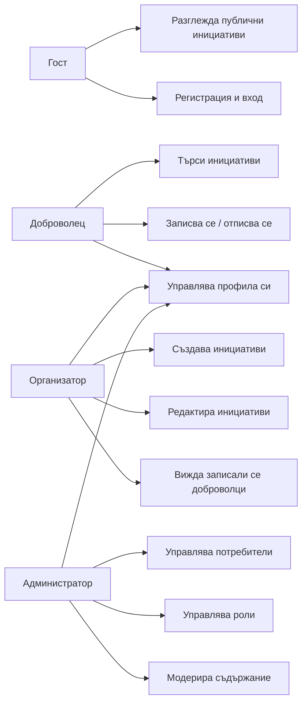

# Съседско – платформа за доброволчество в квартала

## Етап 1. Анализ и планиране

### Тема и предназначение
**Съседско** е уеб платформа, която свързва хора, организиращи малки местни инициативи (почистване на двор, помощ за възрастни хора, уроци за деца), с доброволци от същия квартал.

### Проблем и основна цел
Много хора искат да помагат, но не знаят къде и кога има нужда. Организаторите пък трудно намират хора за кратки, местни инициативи – обявите са разпръснати из социалните мрежи и групи за чат.

**Основна цел:** на едно място организаторите да публикуват инициативи, а доброволците да ги намират и да се записват за минути.

### Потребителски роли и действия

| Роля | Основни функционалности |
|---|---|
| Администратор | Управлява потребители и роли, премахва неподходящо съдържание |
| Организатор | Създава и редактира инициативи, вижда записалите се доброволци |
| Доброволец | Разглежда инициативи, записва се и се отписва, поддържа профил |
| Гост | Разглежда публичните инициативи, може да се регистрира или да влезе |

### Диаграма на функционалностите



## Етап 2. Визуална идентичност и дизайн

### Име
**Съседско** – кратко, на български и описва точно за кого е платформата.

### Лого
Къщичка със сърце в нея, на тъмен заоблен фон (файл `public/logo.svg`). Показва, че помощта започва от дома и квартала.

### Цветова палитра

| Роля на цвета | Цвят | HEX |
|---|---|---|
| Основен | Тъмна петролена синьо-зелена | `#14505C` |
| Вторичен | Топла охра | `#E9A23B` |
| Фон | Хладно светло сиво-зелено | `#F6F8F7` |
| Акцент | Корал | `#E4572E` |
| Текст | Много тъмно синьо-зелено | `#1B2A2E` |

### Типография
- **Заглавия:** Lora (сериф, топъл и четлив, поддържа кирилица).
- **Основен текст:** Manrope (чист и модерен безсериф, поддържа кирилица).

### Концепция
Спокоен и човешки дизайн: тъмен основен цвят за доверие, охра за топлина. Карточките на инициативите имат охрена лява ивица – единственият повтарящ се цветен знак. Без излишни украшения, с големи заглавия и много въздух.

### Примерен дизайн на началната страница
1. **Хедър** – лого, навигация, бутони „Вход“ и „Регистрация“.
2. **Hero** на тъмния основен цвят със заглавие „Половин час за съседа ти е достатъчен, за да се промени един квартал.“ и два бутона.
3. **Предстоящи инициативи** – решетка от карточки.
4. **Футър** с авторско право.

## Етап 3 и 4. React приложение

Структура: `components` (Header, Footer, Main, Sidebar, Button, Card), `layouts` (MainLayout, DashboardLayout), `pages` (Начало, Вход, Регистрация, Профил, Админ панел, Организатор, Доброволец), `context` (демо автентикация).

**Стартиране:**
```
npm install
npm run dev
```
При входа се избира роля (демо), за да може да се видят страниците за всяка роля. Защитените маршрути пренасочват неоторизираните потребители.
